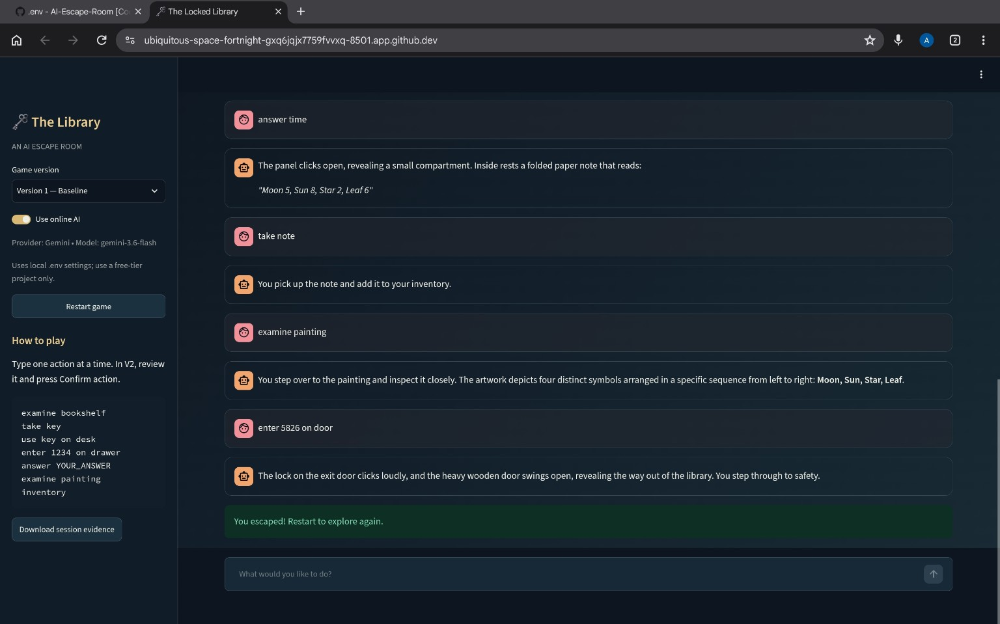
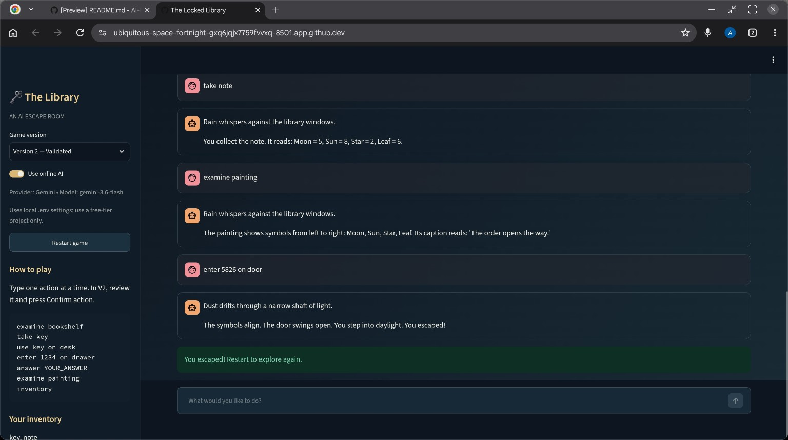

# The Locked Library — AI Escape Room

A Python game that demonstrates why an LLM should not be the sole authority for
application state. Explore five objects, solve three connected puzzles and escape.
Version 1 delegates the game to Gemini; Version 2 validates every move in Python.

**Status (14 November 2026):** both versions implemented and demonstrated online.
Complete eight-action Gemini playthroughs and two invalid-action observations for
each version are preserved. Both versions rejected the two invalid actions; no
V1 failure is claimed from these observations. V2 adds independent Python rule
validation. The automated suite has 49 passing checks; five additional offline
rejection examples are documented separately from live evidence.

Technologies: Python, Streamlit, Google Gen AI SDK, python-dotenv and pytest.

## Quick start (Python 3.11+)

```bash
git clone https://github.com/AlokKevadiya/AI-Escape-Room.git
cd AI-Escape-Room
python -m venv .venv
# Windows PowerShell:
.venv\Scripts\Activate.ps1
# macOS/Linux (instead of the Windows command):
source .venv/bin/activate
python -m pip install -r requirements.txt
python -m streamlit run app.py
```

Open the local URL printed by Streamlit (normally http://localhost:8501).
V2 offline practice starts without an account or API key. Use one command at a time;
review the interpreted action, then press **Confirm action**. Cancel leaves state
unchanged. Switching version/mode or restarting starts a fresh session.

### Enable Gemini for the assignment

1. Create a key in [Google AI Studio](https://aistudio.google.com/apikey).
2. Use a project **without billing** and select a text model currently available
   to you on the [free tier](https://ai.google.dev/gemini-api/docs/pricing).
   Model availability and quota change, so the project intentionally has no hardcoded default.
3. Copy `.env.example` to `.env` in the repository root. Enter your key in
   `GEMINI_API_KEY` and the model ID in `GEMINI_MODEL` (no `models/` prefix needed).
4. Restart Streamlit, enable **Use online AI**, and select V1 or V2.
5. Do not paste the key into chat, source code, screenshots or GitHub.

A ChatGPT subscription is unrelated to this API. No training, GPU or paid API is
needed. The app cannot determine your billing status: keep billing disabled.
V1 makes one API request per message; V2 normally makes two per confirmed move
(interpretation and constrained atmosphere). Quota/network failures are handled
without exposing raw exceptions or credentials. No automatic retry loop is used.

## How to play

Start with `examine bookshelf`. Other examples: `examine drawer`, `take key`,
`use key on desk`, `enter 1234 on drawer`, `answer YOUR_ANSWER`, `inventory`,
`examine painting`. Online mode can interpret broader natural language.
The number 1234 above is just a syntax example, not a solution.

The room has a bookshelf, drawer, desk, painting and exit door. The three puzzles
are seasonal ordering, a desk riddle, and matching symbols to an exit code.
The win condition also requires collected evidence and completed prerequisite puzzles.
See [the spoiler walkthrough](docs/WALKTHROUGH.md) only when testing or presenting.

## Versions and architecture

| Topic | V1 baseline | V2 improved |
|---|---|---|
| State | Conversation history | Python dataclass in session state |
| Decisions | LLM follows prompt | Pure Python transition function |
| Inventory | Model remembers | Explicit collected-item list |
| Secrets sent to model | Full puzzle prompt | No author solutions in parser/narrator prompts |
| Narration | Free-form generated text | Validated outcome plus model-selected safe atmosphere |
| Input handling | Unrestricted language | Structured proposal, confirmation, rule checks |
| Win detection | Model marker (untrusted) | Required conditions and exact final code |

The V2 tradeoff is less creative narration and an extra confirmation click. This
is deliberate: unconstrained prose could claim an impossible outcome even when
backend state is safe. This project does not claim to solve prompt injection in
general. See [architecture diagrams](docs/ARCHITECTURE.md).

Both versions remain selectable in the current app. `escape_room/v1.py` is the
baseline; `engine.py` and `v2.py` implement the improved version. GitHub branch `version-1`
records the original baseline app; `version-2` records the first V2 implementation.
Later commits add tests, documentation and refinements. The four saved development
milestones were replayed onto GitHub after repository creation; their contents and
order are preserved, with new commit IDs. History was not backdated.

## Tests and evidence

```bash
python -m pip install -r requirements-dev.txt
python -m pytest -q
```

[49 automated checks passed](docs/automated-test-results.txt) locally on 14 November
2026 using Python 3.12. GitHub Actions is configured for Python 3.11; check the repository's Actions tab
for its current result. The local result above is distinct from hosted CI. API responses are mocked in relevant automated
tests; these do not establish actual Gemini behavior.

- [Test cases and V1/V2 comparison](docs/TESTING.md)
- [Updated three-page project report](docs/Project_Report.pdf)
- [V1 online success transcript](docs/evidence/v1-online-success.json)
- [Observed online comparison](docs/evidence/online-comparison.md)
- [V2 online success transcript](docs/evidence/v2-online-success.json)
- [Online setup and alternative provider](docs/ONLINE_SETUP.md)
- [Demonstration and submission checklist](docs/DEMO.md)
- [Code explanation for class](docs/EXPLAINING_THE_CODE.md)

Use **Download session evidence** to save real play sessions. Inspect them for
private information before committing them. Live V1 failures must be observed;
the report does not fabricate them.

## Project map

| Path | Purpose |
|---|---|
| `app.py` | Streamlit UI, session lifecycle, confirmation and transcript download |
| `escape_room/world.py` | Room description and author-owned puzzle rules |
| `escape_room/llm.py` | Provider selection, timeouts and safe error messages |
| `escape_room/interactions.py`, `groq_adapter.py` | Optional API transports |
| `escape_room/v1.py` | Conversational baseline |
| `escape_room/engine.py` | State, inventory and authoritative validation |
| `escape_room/v2.py` | Untrusted model parsing and constrained narration |
| `tests/` | Engine, adversarial, mocked-model and Streamlit tests |
| `docs/` | Architecture, evidence, report and presentation guide |

## Limitations and privacy

State lasts for the active Streamlit session, not across server restarts. It is not
a database-backed multiplayer game. Offline parsing recognizes a limited grammar;
online parsing can misunderstand input, so players confirm the proposed action.
Source code and tests contain puzzle answers: this is educational game logic,
not a secure way to hide answers from someone reading the repository.
V1 sends conversation history to the selected provider (Gemini by default, Groq
optional); V2 sends the current action and a separate
fixed list of atmosphere options. Do not enter personal information. Logs and
transcripts are local unless you explicitly download/share them.

## Sources and authorship

Uses [Streamlit](https://docs.streamlit.io/), the
[Google Gen AI Python SDK](https://googleapis.github.io/python-genai/) and
[Gemini generateContent](https://ai.google.dev/api/generate-content).
`requirements-lock.txt` records the full local test environment; normal setup uses
the shorter requirements files. Built for AlokKevadiya with AI coding assistance.
The student should review and personalize the implementation and report, perform
live tests, and be able to explain every submitted component.

## Repository and submission

Repository: https://github.com/AlokKevadiya/AI-Escape-Room. Submit this URL.
The repository is private: the owner must grant the instructor access or explicitly
choose to publish it before submission. A Codespaces forwarded app URL is temporary
and is not a substitute for repository access. See [requirement mapping](docs/REVIEW.md).

## Online demonstrations

### V1: model-managed game



This screenshot records an earlier successful V1 session. A subsequent complete
repeat was exported as [V1 online success](docs/evidence/v1-online-success.json).

### V2: Python-validated game



The [V2 transcript](docs/evidence/v2-online-success.json) includes explicit final
state. Screenshots and exports are user-recorded evidence reviewed on 14 November
2026; they are not signed provider logs or reliability benchmarks.
