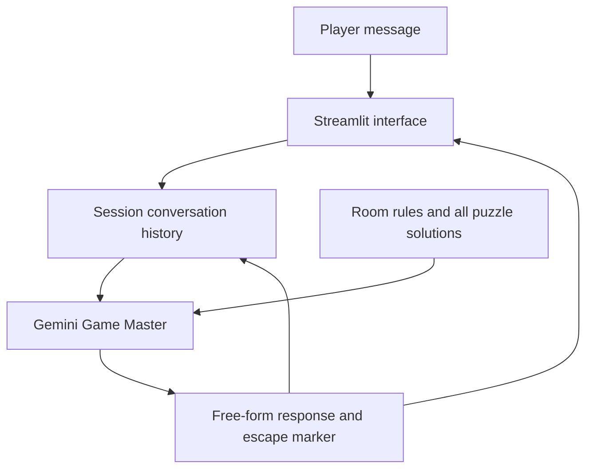
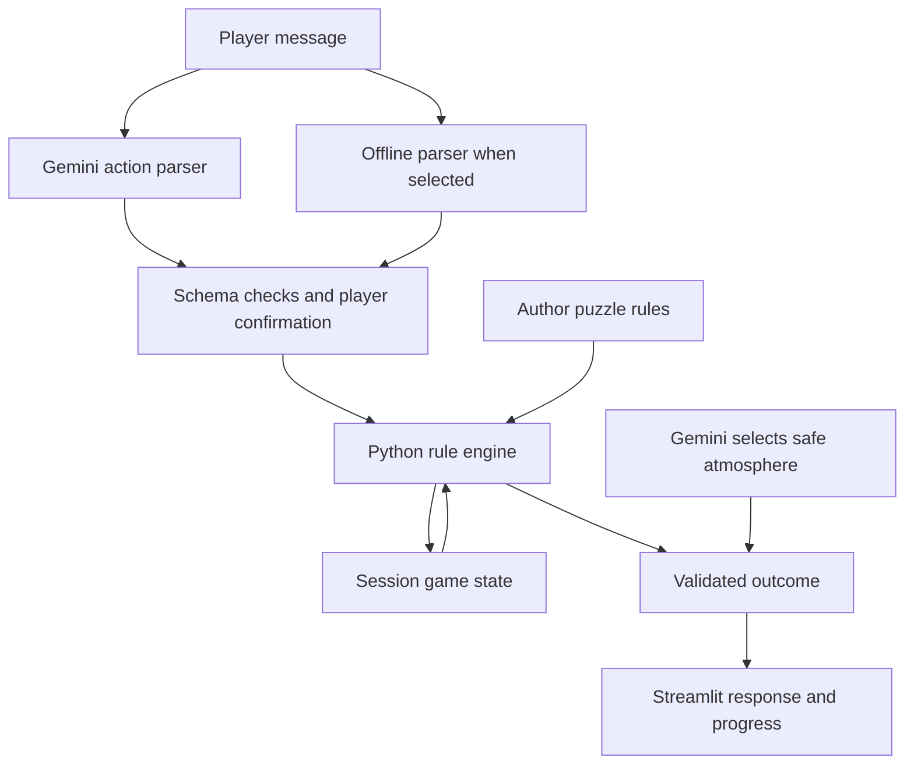

# System architecture

## Version 1: conversational authority

The model decides what happens. The UI trusts its escape marker. The prompt asks
for consistent behavior, but there is no independent inventory or rule enforcement.

## Version 2: validated authority

The parser returns only a proposal. It has no function that writes state and does
not receive author solutions. Code/answer values must appear literally in the
player's message. Player confirmation protects against interpretation mistakes;
Python still checks prerequisites after confirmation. The engine copies state
before evaluating a transition, so rejected moves cannot partially update it.

Game facts always come from the engine. The atmosphere model can select only
one of three developer-written sentences; unexpected output is discarded. Its
failure does not roll back a legitimately completed action. Parser failure occurs
before confirmation and cannot apply an action. Restart replaces state and history.

## Provider selection

The diagrams show the verified Gemini route. `llm.py` also supports an explicit
Groq provider selection and an optional Gemini Interactions transport. These use
the same application-level interfaces and rule engine. Only Gemini generateContent
with gemini-3.6-flash has a reviewed full online walkthrough. Groq JSON object mode
does not enforce the requested schema server-side; local proposal validation is
still required. No automatic switch to another provider occurs.
